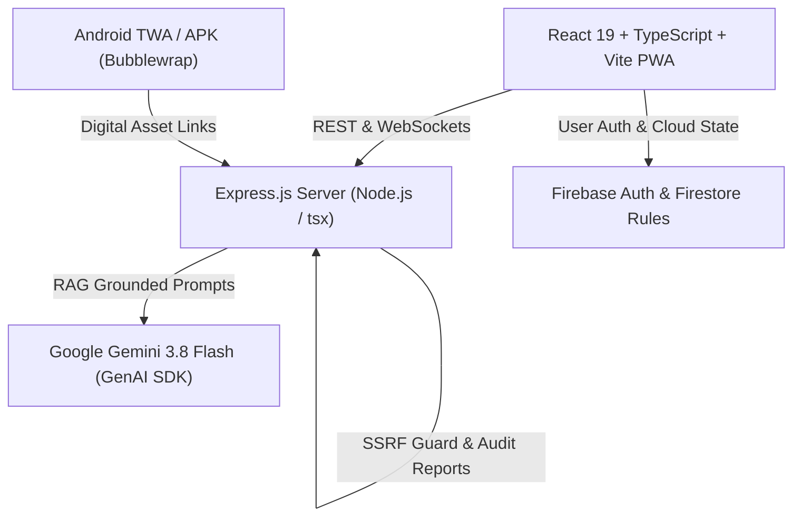

# Grama Sahayya AI 🌾 (గ్రామ సహాయ AI)

[](https://grama-sahayya-ai.onrender.com)
[](LICENSE)
[](https://react.dev/)
[](https://www.typescriptlang.org/)
[](https://vitejs.dev/)
[](https://ai.google.dev/)
[](public/downloads/grama-sahayya-ai.apk)

> **Government Services, Made Simple for Every Citizen.**  
> An AI-powered, multilingual civic intelligence platform that empowers citizens to discover government welfare schemes, evaluate eligibility, prepare error-free applications, and access verified digital public services in Telugu, English, and regional languages.

---

## 📑 Table of Contents

- [Vision & Problem Statement](#-vision--problem-statement)
- [Key Features](#-key-features)
- [Architecture & Tech Stack](#-architecture--tech-stack)
- [Project Structure](#-project-structure)
- [API Reference](#-api-reference)
- [Installation & Local Setup](#-installation--local-setup)
- [Android App & TWA Build Pipeline](#-android-app--twa-build-pipeline)
- [Security & Data Integrity](#-security--data-integrity)
- [Automated Testing Suite](#-automated-testing-suite)
- [Flagship Welfare Programs Supported](#-flagship-welfare-programs-supported)
- [Disclaimer](#-disclaimer)
- [Contributing & License](#-contributing--license)

---

## 💡 Vision & Problem Statement

Millions of citizens in rural and semi-urban India miss out on crucial welfare schemes due to:
1. **Language Barriers**: Complex bureaucratic documents in formal legal English or heavy administrative phrasing.
2. **Fragmented Portals**: Dozens of disconnected state and central portals with inconsistent navigation.
3. **Information Asymmetry & Stale Data**: Uncertainty about current vs. discontinued programs and inaccurate eligibility requirements.
4. **Application Dropouts**: Incomplete document preparation leading to rejection at Village / Ward Secretariats (*గ్రామ/వార్డు సచివాలయం*).

**Grama Sahayya AI** addresses these challenges by serving as an empathetic, truthful, bilingual digital public assistant. It grounds AI responses strictly in authoritative government datasets with zero hallucinations, dynamic language detection, and end-to-end application guidance.

---

## ✨ Key Features

### 🤖 Multilingual Gemini-Powered AI Assistant
- **Dynamic Language Switching**: Automatically detects whether the user's latest query is in **Telugu script**, **Telugu-English code-mixed (Tanglish)**, or **English**, and replies in the matching dialect and tone.
- **Strict RAG Grounding**: Responses are grounded exclusively in verified official datasets; the model never hallucinates schemes, benefits, or unofficial links.
- **Voice-Enabled Interface**: Integrated Web Speech API for voice recognition (Speech-to-Text) and natural speech synthesis (Text-to-Speech) in Telugu and English.
- **Rich Markdown Formatting**: Answers include structured comparison tables, step-by-step checklists, direct application links, and official toll-free helplines.

### 📋 Verified Scheme Catalog & Instant Eligibility Calculator
- **Comprehensive Scheme Database**: Categorized by Agriculture, Education, Healthcare, Social Security Pensions, Housing, and Women & SHG Welfare.
- **Real-Time Eligibility Engine**: Evaluates citizen demographics (age, annual family income, occupation, land holding, gender, social category, AP residency) against scheme rules.
- **Historical Scheme Transition Guidance**: Transparently informs citizens about legacy scheme status (e.g. YSR-branded programs) and provides direct links to active programs (e.g., *Annadata Sukhibhava*, *Dr. NTR Vaidya Seva*, *NTR Bharosa*, *Talliki Vandanam*, *Aadabidda Nidhi*, *Sthree Shakthi*).

### 📑 Guided Application Preparation & Tracking
- **Document Readiness Checklist**: Outlines mandatory certificates (Aadhaar, Rice Card, Income Certificate, Caste Certificate, Land Records) before visiting the secretariat.
- **Application Tracker**: Citizens can track their progress through customizable milestones (*Interested*, *Documents Preparing*, *Ready to Submit*, *Submitted*).
- **Persistent State**: Full synchronization with Firebase Firestore and browser LocalStorage fallback for offline continuity.

### 🏛️ Digital Public Services Directory
- **Direct Portal Access**: Fast access to 10+ core citizen services including Aadhaar (UIDAI), PAN Card, Voter ID, MeeSeva Certificates, AP Land Records (Meebhoomi), AP Civil Supplies, Driving Licenses, and PM Surya Ghar Muft Bijli.
- **Statutory Fee & SLA Transparency**: Clear indication of government fees, processing timelines, and official tracking methods.
- **SSRF-Guarded Link Verifier**: Server-side URL verification with firewall checks to guarantee official `.gov.in` and `.nic.in` portal authenticity.

### 📱 Progressive Web App (PWA) & Android TWA
- **Installable PWA**: Works across desktop and mobile browsers with offline asset caching and service worker support.
- **Signed Android APK & AAB**: Production-grade Trusted Web Activity (TWA) packaged under `ai.gramasahayya.app`, supporting one-click direct APK downloads and Google Play publication readiness.
- **Digital Asset Links**: Built-in verification via `/.well-known/assetlinks.json` for seamless full-screen app execution without browser address bars.

### 🛡️ Admin Portal & Telemetry
- **Official Administrative Dashboard**: Real-time overview of citizen engagement metrics, catalog verification status, and audit reports.
- **Scheme & Service Management**: Audit logs, export/import utilities, and security-hardened rule enforcement.

---

## 🛠️ Architecture & Tech Stack



| Layer | Technologies |
|---|---|
| **Frontend Framework** | React 19, TypeScript, Vite 8 |
| **Styling & Icons** | TailwindCSS v4, Lucide React, Motion (Framer Motion) |
| **Markdown & Formatting** | React Markdown, Remark GFM |
| **Backend & API** | Node.js, Express.js 4, `tsx`, `esbuild` |
| **Artificial Intelligence** | `@google/genai` (Google Gemini 3.8 Flash) |
| **Database & Auth** | Firebase Authentication, Google Sign-In, Cloud Firestore |
| **Mobile Packaging** | Trusted Web Activity (TWA), Google Bubblewrap CLI, Adoptium JDK 17, Android SDK |
| **Testing** | Node / tsx Test Runners, 9 End-to-End Assertion Suites |
| **Hosting & Deployment** | Render (Web Service), Cloud Run ready |

---

## 📁 Project Structure

```text
grama-sahayya-ai/
├── android/                        # Android TWA project files & release keystore
├── public/                         # Static assets, icons, downloads & PWA manifest
│   ├── .well-known/                # Digital Asset Links (assetlinks.json)
│   ├── downloads/                  # Prebuilt signed Android APK
│   ├── favicon.svg
│   └── manifest.json               # Progressive Web App manifest
├── scripts/                        # Build automation & utility scripts
│   ├── build-android.ps1           # Automated PowerShell APK/AAB build pipeline
│   ├── generate-twa.cjs            # Bubblewrap configuration generator
│   └── update-app-icons.py         # Multi-density icon generator
├── src/
│   ├── components/                 # React UI components
│   │   ├── AdminDashboard.tsx      # Administrative management & telemetry
│   │   ├── ApplicationPreparationWorkflow.tsx # Document checklists & application prep
│   │   ├── ApplicationTracker.tsx  # Application lifecycle tracking
│   │   ├── AssistantChat.tsx       # AI chat interface with speech & markdown
│   │   ├── AuthModal.tsx           # Firebase authentication dialog
│   │   ├── ChatMessageContent.tsx  # Markdown & scheme card renderer
│   │   ├── CitizenDashboard.tsx    # Citizen portal & recommendation dashboard
│   │   ├── EligibilityCheckerModal.tsx # Interactive criteria checker
│   │   ├── InstallAppPopup.tsx     # PWA & APK install banner
│   │   ├── LandingPage.tsx         # Hero section & quick discovery
│   │   ├── Navbar.tsx              # Navigation & language switcher
│   │   ├── OnboardingModal.tsx     # Demographic profile questionnaire
│   │   ├── PublicServicesDirectory.tsx # MeeSeva & central services directory
│   │   ├── SchemeCatalog.tsx       # Filterable welfare scheme catalog
│   │   └── VoiceBar.tsx            # Speech recognition & synthesis controls
│   ├── context/                    # React Context (Auth, Language, Telemetry)
│   ├── data/                       # Authoritative scheme & service catalogs
│   │   ├── schemes.ts              # Verified active AP & Central schemes
│   │   ├── publicServices.ts       # Verified digital public services
│   │   ├── archivedHistoricalSchemes.ts # Legacy catalog (audit continuity)
│   │   └── archivedHistoricalPublicServices.ts
│   ├── firebase/                   # Firebase configuration & Firestore helpers
│   ├── hooks/                      # Custom hooks (Speech, PWA install, Storage)
│   ├── i18n/                       # Localization dictionaries (Telugu, English, Hindi)
│   ├── types/                      # TypeScript domain models
│   ├── utils/                      # SSRF guard, language detector, scheme normalizer
│   ├── App.tsx                     # Main layout and tab orchestrator
│   └── main.tsx                    # Client entrypoint
├── tests/                          # Automated verification tests (9 test suites)
├── firestore.rules                 # Production Firestore security rules
├── security_spec.md                # Adversarial testing & PII isolation spec
├── server.ts                       # Express server with Gemini RAG & API routes
├── package.json
├── tsconfig.json
└── vite.config.ts
```

---

## 🔌 API Reference

### Core Endpoints

#### 1. Gemini Chat Assistant
```http
POST /api/chat
```
**Request Body:**
```json
{
  "message": "రైతులకు ఉన్న ప్రస్తుత పథకాలు ఏమిటి?",
  "language": "te",
  "conversationHistory": [],
  "citizenProfile": {
    "isFarmer": true,
    "state": "Andhra Pradesh",
    "district": "Guntur"
  }
}
```
**Response:**
```json
{
  "reply": "నమస్కారం! ఆంధ్రప్రదేశ్ రాష్ట్ర ప్రభుత్వం రైతులకు **అన్నదాత సుఖీభవ మరియు పీఎం-కిసాన్** పథకం ద్వారా ఏటా ₹20,000 పెట్టుబడి సాయం అందిస్తోంది...",
  "language": "te",
  "detectedLanguage": "te",
  "isMixedLanguage": false,
  "recommendedSchemeIds": ["annadata-sukhibhava-ap"],
  "timestamp": "2026-10-20T18:45:00.000Z"
}
```

#### 2. Verified Schemes Directory
```http
GET /api/schemes?category=agriculture&govLevel=state&search=sukhibhava
```
Returns list of verified schemes matching filters, sanitized of legacy branding.

#### 3. Public Services Directory
```http
GET /api/public-services?category=identity&govLevel=central
```
Returns verified public services with official URLs, statutory fees, and SLA timelines.

#### 4. Safe URL Verifier (SSRF-Protected)
```http
POST /api/public-services/verify-url
```
**Request Body:** `{"url": "https://myaadhaar.uidai.gov.in"}`  
Validates the target URL against strict DNS/IP firewall rules to prevent SSRF and confirms live HTTP status.

#### 5. Mobile App Info & APK Availability
```http
GET /api/app-info
```
Returns current package ID (`ai.gramasahayya.app`), version, download link, and SHA-256 fingerprint.

#### 6. System Telemetry & Catalog Audit
```http
GET /api/system-stats
GET /api/public-services/audit-report
GET /api/health
```
Delivers authoritative counts of active vs. archived programs and platform health status.

---

## 🚀 Installation & Local Setup

### Prerequisites

- [Node.js](https://nodejs.org/) (v20.x or higher)
- [npm](https://www.npmjs.com/) (v10.x or higher)
- [Google Gemini API Key](https://aistudio.google.com/app/apikey)
- A Firebase project (for Authentication & Cloud Firestore)

### 1. Clone the Repository
```bash
git clone https://github.com/darsan-0/grama-sahayya-ai.git
cd grama-sahayya-ai
```

### 2. Install Dependencies
```bash
npm install
```

### 3. Configure Environment Variables
Copy `.env.example` to create `.env`:
```bash
cp .env.example .env
```
Populate the required credentials in `.env`:
```dotenv
# Gemini API Key (Required for chat AI)
GEMINI_API_KEY=your_gemini_api_key_here

# App URL (Used for links and OAuth callbacks)
APP_URL=http://localhost:3000

# Server Port (Defaults to 3000)
PORT=3000
```

### 4. Run the Development Server
```bash
npm run dev
```
Open your browser and navigate to:
```
http://localhost:3000
```
> In development mode, Vite's SPA middleware is mounted inside Express with hot module replacement (HMR).

### 5. Build for Production
```bash
# Builds Vite client and bundles the Express server
npm run build

# Start production server
npm start
```

---

## 📱 Android App & TWA Build Pipeline

Grama Sahayya AI provides a built-in automated build pipeline for compiling a native **Signed Android APK** and **Android App Bundle (AAB)** using Google Bubblewrap and Trusted Web Activity (TWA).

### Build Prerequisites
- **Adoptium Temurin JDK 17**
- **Android Command-Line Tools / Android SDK** (Build Tools 34.0.0, API Level 34)
- **Bubblewrap CLI** (`npm install -g @bubblewrap/cli`)

### Run Automated Build
Execute the automated PowerShell pipeline:
```powershell
npm run build:android
```
Or directly:
```powershell
powershell -ExecutionPolicy Bypass -File scripts/build-android.ps1
```

### Build Deliverables
- **Signed APK**: `public/downloads/grama-sahayya-ai.apk` (also served at `/downloads/grama-sahayya-ai.apk`)
- **Signed AAB**: `android/app-release-bundle.aab` (ready for Google Play Store upload)
- **Asset Links**: Validated SHA-256 certificate fingerprint served at `/.well-known/assetlinks.json`

---

## 🔒 Security & Data Integrity

The project adheres to a strict security architecture documented in [`security_spec.md`](security_spec.md):

1. **PII Isolation & Least Privilege**:
   - Citizen PII (phone numbers, private identifiers) is isolated in restricted subcollections accessible only by the owning authenticated user or verified admins.
2. **"Dirty Dozen" Adversarial Testing**:
   - Firestore security rules protect against 12 known threat vectors, including foreign UID hijacking, role escalation, scheme tampering, denial-of-wallet spamming, and immutable field alteration.
3. **SSRF Guard**:
   - The `/api/public-services/verify-url` endpoint prohibits requests to local hostnames, private RFC 1918 IPv4/IPv6 ranges, link-local addresses, and AWS/GCP metadata endpoints (`169.254.169.254`).
4. **Data Grounding Guarantee**:
   - AI generation strictly injects curated, verified scheme parameters into system instructions, preventing hallucinated URLs or unofficial phone numbers.

---

## 🧪 Automated Testing Suite

The codebase features comprehensive unit, integration, and security tests. Execute all suites via:

```bash
npm test
```

### Test Coverage Highlights:
- **`eligibility_and_security.test.ts`**: Validates eligibility assessment formulas and security firewall boundaries.
- **`auth_and_analytics.test.ts`**: Verifies role permissions, Google auth handling, and telemetry aggregation.
- **`multilingual_chat.test.ts`**: Validates Telugu, English, and code-mixed language detection and response matching.
- **`scheme_exclusion_and_current_catalogue.test.ts`**: Guarantees legacy YSR schemes are excluded from the public catalog and replaced with active AP programs.
- **`chat_markdown_rendering.test.ts`**: Validates markdown sanitization, tables, lists, and links.
- **`application_workflow_persistence.test.ts`**: Tests document readiness tracking and state persistence.
- **`public_services_and_pwa.test.ts`**: Checks public service schemas, SLAs, and PWA manifest attributes.
- **`install_popup_minimal.test.ts`**: Tests non-intrusive install prompt dismissal and cooldowns.
- **`android_app_and_twa.test.ts`**: Validates TWA configuration, Digital Asset Links, and APK download availability.

To verify TypeScript types without emitting code:
```bash
npm run lint
```

---

## 🌾 Flagship Welfare Programs Supported

Grama Sahayya AI provides verified guidance on active flagship initiatives in Andhra Pradesh and Central Government schemes:

| Scheme Name | Category | Primary Benefit | Official Portal |
|---|---|---|---|
| **Annadata Sukhibhava & PM-KISAN** | Agriculture | ₹20,000/year farmer investment support | [annadathasukhibhava.ap.gov.in](https://annadathasukhibhava.ap.gov.in) |
| **Dr. NTR Vaidya Seva** | Healthcare | ₹25 Lakhs universal cashless treatment | [drntrvaidyaseva.ap.gov.in](https://drntrvaidyaseva.ap.gov.in) |
| **Talliki Vandanam** | Education | ₹15,000/year per school/college student | [gramawardsachivalayam.ap.gov.in](https://gramawardsachivalayam.ap.gov.in) |
| **NTR Bharosa Social Security Pension** | Pensions | ₹4,000 to ₹15,000/month for seniors, widows & PwD | [sspensions.ap.gov.in](https://sspensions.ap.gov.in) |
| **Aadabidda Nidhi** | Women Welfare | ₹1,500/month direct support for women aged 18–59 | [wdcw.ap.gov.in](https://wdcw.ap.gov.in) |
| **APSRTC Sthree Shakthi** | Women Welfare | 100% Free bus travel across AP | [apsrtc.ap.gov.in](https://apsrtc.ap.gov.in) |
| **PM Surya Ghar: Muft Bijli Yojana** | Energy / Housing | Up to ₹78,000 solar subsidy + 300 units free power | [pmsuryaghar.gov.in](https://pmsuryaghar.gov.in) |
| **Deepam 2.0 (Free LPG Scheme)** | Energy / Women | 3 Free LPG cylinders annually for BPL households | [civilsupplies.ap.gov.in](https://civilsupplies.ap.gov.in) |

---

## ⚠️ Disclaimer

> **Public Information Notice**: Grama Sahayya AI is an independent, open-access civic technology initiative designed to help citizens understand and navigate welfare programs. It is **not** an official government agency and cannot sanction or disburse benefits. Scheme guidelines, eligibility parameters, and deadlines are subject to official government notifications. Citizens are advised to verify details with their local **Village/Ward Secretariat (గ్రామ/వార్డు సచివాలయం)**, **MeeSeva Centre**, or official government portals before submitting legal applications.

---

## 🤝 Contributing & License

Contributions, bug reports, and suggestions are welcome!

1. Fork the repository.
2. Create a descriptive feature branch: `git checkout -b feature/new-service-directory`.
3. Commit your changes adhering to conventional commit guidelines: `git commit -m "feat: add digital locker service guidance"`.
4. Run tests: `npm test` and `npm run lint`.
5. Push to your branch and open a Pull Request.

### License
This project is open-sourced under the [MIT License](LICENSE).
